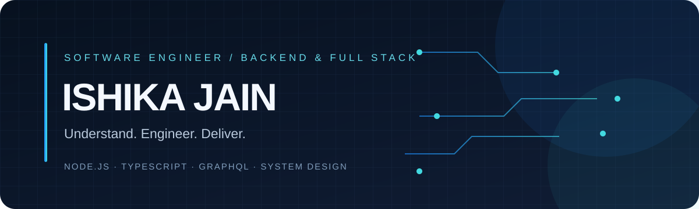

<!--
  Ishika Jain — GitHub Profile README
  Keep README.md, profile-banner.svg and assets/ together.
-->

  

    

  
  &nbsp;
  
  &nbsp;
  

 

## ✨ Ideas. Built Different.

*I turn complex requirements into practical, scalable software — with thoughtful backend engineering and clean product experiences.*

<table>
<tr>
<td width="50%" valign="top">

### 💡 What I Build

- Scalable backend services and REST APIs
- GraphQL services and microservice-based systems
- Full-stack web applications
- Real-time features and event-driven workflows
- Database-backed business platforms

</td>
<td width="50%" valign="top">

### ⚙️ How I Work

- Understand the problem and existing workflows
- Design maintainable APIs and data models
- Build with security, reliability and performance in mind
- Debug, optimize and continuously improve
- Deliver collaboratively — from idea to implementation

</td>
</tr>
</table>

---

## 🧩 03 · What I Do

*Engineering services across the product lifecycle*

<table>
<tr>
<td width="33%" valign="top">

### 🌐 Full Stack Development

End-to-end web application development with React, Next.js and Node.js.

</td>
<td width="33%" valign="top">

### ⚙️ Backend Development

Modular backend services, business logic and scalable application architecture.

</td>
<td width="33%" valign="top">

### 🔗 REST API Development

Secure, structured APIs designed for dependable integrations and maintainability.

</td>
</tr>
<tr>
<td valign="top">

### ◇ GraphQL Development

Schema design, resolvers, subscriptions and efficient data access.

</td>
<td valign="top">

### ▦ Microservices Architecture

Service boundaries, asynchronous processing and distributed workflows.

</td>
<td valign="top">

### 🗄️ Database Design

Relational and NoSQL data modeling, query tuning and caching.

</td>
</tr>
<tr>
<td valign="top">

### ⚡ Real-Time Applications

Live updates, notifications and event-driven communication.

</td>
<td valign="top">

### 🔐 Authentication & Security

JWT, role-based access control and secure API practices.

</td>
<td valign="top">

### ☁️ Cloud & DevOps

Containerized deployments and cloud-based application workflows.

</td>
</tr>
<tr>
<td valign="top">

### ✧ AI Integration

Integrating AI capabilities and external model APIs into applications.

</td>
<td valign="top">

### 📈 Performance Optimization

Debugging, logging, error handling and application performance improvements.

</td>
<td valign="top">

### ✦ Freelance Development

Independent development support for product ideas, features and backend systems.

</td>
</tr>
</table>

---

## 🛠️ 04 · Technology Ecosystem

*Tools and technologies I work with*

<table>
<tr>
<td width="50%" valign="top">

### 🎨 Frontend

### 🚀 Backend

REST APIs · GraphQL · Socket.IO · Microservices

</td>
<td width="50%" valign="top">

### 🗄️ Database & Caching

### ☁️ Cloud & DevOps

BullMQ · Render · Cloud Scheduler

</td>
</tr>
<tr>
<td valign="top">

### 🔧 Tools & Collaboration

</td>
<td valign="top">

### 📐 Engineering Practices

System Design · Database Design · API Design · Microservices Architecture · JWT · RBAC · Performance Optimization · Logging & Error Handling

</td>
</tr>
</table>

---

## 🚀 05 · Things I've Built

*Selected projects and engineering work*

<table>
<tr>
<td width="50%" valign="top">

### 🐾 PetPass Platform Migration & Modernization

Modernization of a legacy veterinary platform, moving core services from an ASP.NET and SQL Server foundation to a Node.js, TypeScript, GraphQL and PostgreSQL stack on GCP.

**Focus:** legacy migration · real-time workflows · integrations · background jobs

Node.js · TypeScript · GraphQL · PostgreSQL · GCP · Socket.IO · Redis · BullMQ

</td>
<td width="50%" valign="top">

### 🦷 Dental & Aligner Management System

Application for patient records, dental and aligner treatments, appointments, prescriptions, lead management and operational dashboards.

**Focus:** patient workflows · role-based access · dashboards · real-time updates

Node.js · Express.js · MySQL · JWT · RBAC · React

</td>
</tr>
<tr>
<td width="50%" valign="top">

### 🤖 AI Interview Assessment Platform

AI-assisted interview practice platform with voice and camera recording, interview analysis and personalized feedback.

**Focus:** interview sessions · AI evaluation · feedback generation

Next.js · Gemini API · PostgreSQL · Neon · Drizzle ORM

</td>
<td width="50%" valign="top">

### 📊 Customer Relationship Management — EcomPulse

Role-based CRM supporting client and lead management, support tickets, tasks, reminders, analytics and data exports.

**Focus:** business workflows · access control · analytics · exports

Node.js · Express.js · MySQL · JWT

</td>
</tr>
</table>

<!-- 

Project visuals above are illustrative placeholders, not product screenshots. Replace them with real screenshots when available.

 -->

---

## 💼 06 · Real Work. Real Impact.

*Professional experience, selected contributions and certifications*

### 🏢 Company Experience

<table>
<tr>
<td width="33%" valign="top" align="center">

<h3>🏥 Meditree Healthcare</h3>

**Software Engineer**

Pune, Maharashtra

<!-- Current company -->

---

Develops backend services, REST APIs, GraphQL services and microservices for healthcare and enterprise applications. Work includes database-backed systems, third-party integrations, asynchronous jobs, real-time workflows and production improvements.

</td>
<td width="33%" valign="top" align="center">

<h3>💻 Inurum Technologies</h3>

**Full Stack Developer**

Indore, Madhya Pradesh

---

Built full-stack web application features using Node.js, Express.js, React.js and TypeScript, including APIs, responsive interfaces, authentication and business workflows.

</td>
<td width="33%" valign="top" align="center">

<h3>⚡ Ixora Infotech Pvt. Ltd.</h3>

**Node.js Developer**

Indore, Madhya Pradesh

---

Developed backend services and REST APIs, implemented JWT authentication and RBAC, and worked with MongoDB, MySQL and PostgreSQL.

</td>
</tr>
</table>

### 🏆 Certifications

<table>
<tr>
<td width="33%" valign="top">

<h3>🎓 Full Stack Developer</h3>

**Capgemini Engineering**

SQL, Core Java

</td>
<td width="33%" valign="top">

<h3>🎓 MERN STACK Developer</h3>

**Broadcast Engineering Consultants India Ltd.**

REST APIs, Back-End Web Development

</td>
<td width="33%" valign="top">

<h3>🎓 Nodejs Developer</h3>

**Coding Ninjas**

Express.js, Node.js

</td>
</tr>
<tr>
<td width="33%" valign="top">

<h3>🎓 Simpilearn SkillUP</h3>

**Simplilearn**

Digital Transformation

</td>
<td width="33%" valign="top">

<h3>🎓 JavaScript Essentials</h3>

**Simplilearn**

JavaScript

</td>
<td width="33%" valign="top">

<h3>🎓 TCS iON Career Edge - Young Professional</h3>

**TCS**

Presentations, Soft Skills

</td>
</tr>
</table>

---

## 🤝 07 · Let's Connect

*Have an idea, a product challenge, or a collaboration in mind? Let's talk.*

<table>
<tr>
<td width="33%" align="center" valign="top">

### 📧 Email

For opportunities and collaborations

</td>
<td width="33%" align="center" valign="top">

### 💼 LinkedIn

Let's connect professionally

</td>
<td width="33%" align="center" valign="top">

### 💻 GitHub

Explore my code and projects

</td>
</tr>
</table>

 

Built with curiosity, care and clean code.

